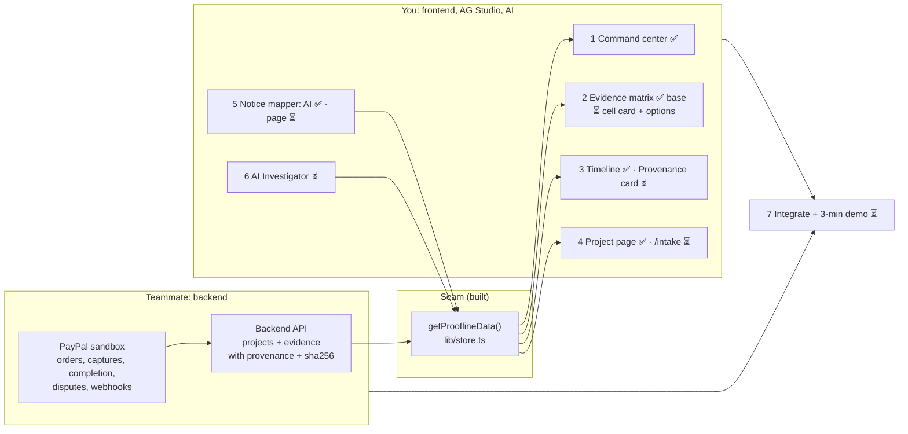

# Proofline status (11 Nov 2026)

- **Built:** Studio command center (KPIs, matrix, donut, gaps, recent activity), timeline widget, project page with
  intake and PayPal actions, AI extract and notice mapping, plus a stand-in backend (SQLite, PayPal calls, webhook route).
- **Teammate:** the real backend replaces `lib/db.ts`, `lib/store.ts`, `lib/paypal.ts`, `app/actions.ts` and the API
  routes; it must return projects and evidence with provenance and sha256, so `getProoflineData()` keeps its shape.
- **You, next:** matrix cell card and Studio options (decided), provenance card, `/notice` page, `/intake`, then the
  AI Investigator agent.
- **Shared, last:** wire the frontend to the teammate's API, deploy, record the demo.
